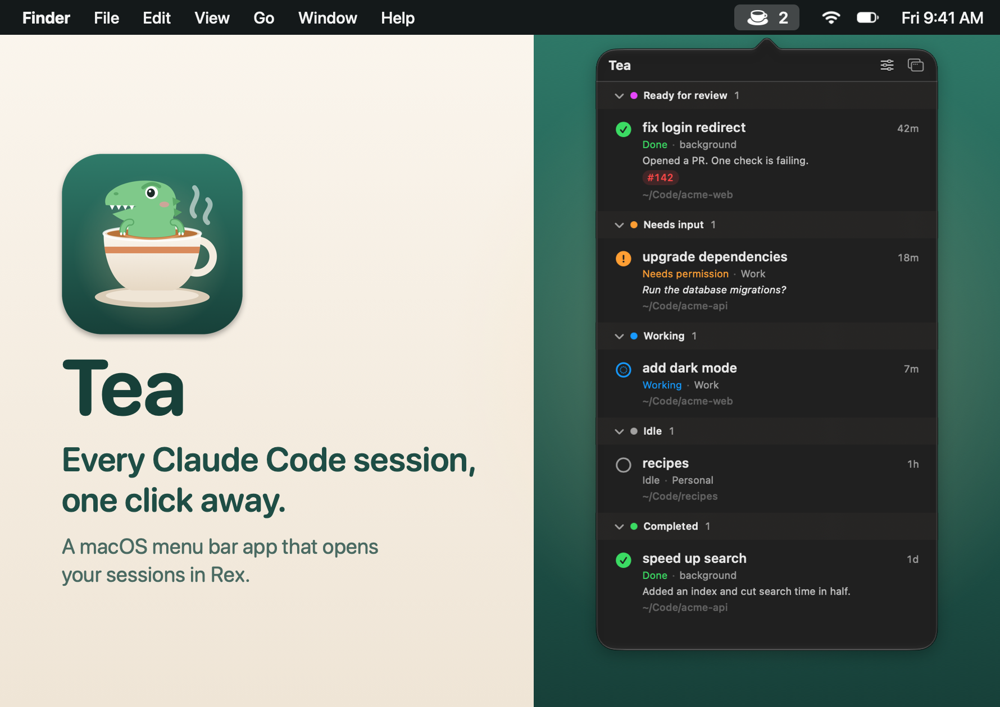
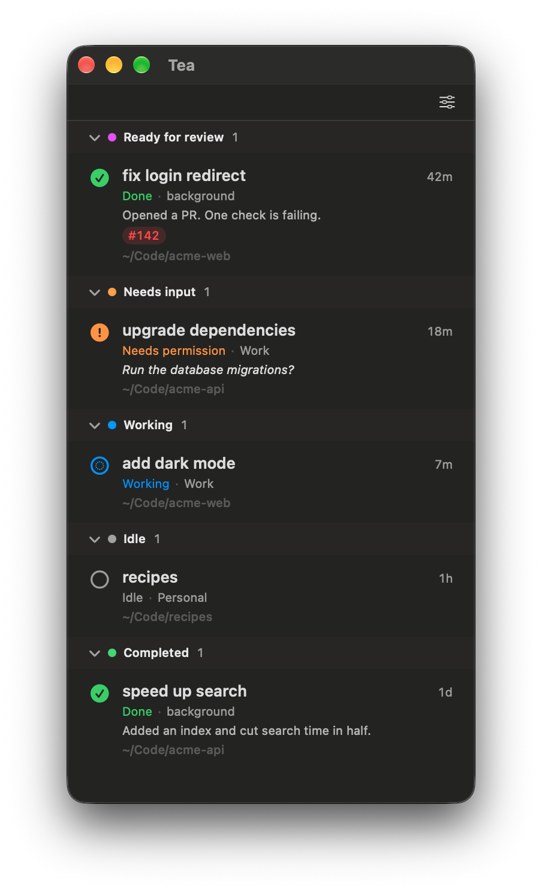

# Tea

Tea is a macOS menu bar app that lists every Claude Code session on your Mac and opens the one you pick in [Rex](https://www.superlogical.com/updates/public-testing-beginning). Sessions that other apps run through the Agent SDK are hidden.

<p align="center"></p>

## Features

- **Sessions grouped by status:** Ready for review, Needs input, Working, Idle and Completed. These follow the groups in the `claude agents` view, with Idle added for interactive sessions that have no background job.
- **Live activity:** each card shows what the session is doing, its Rex location, working directory and age, plus the job summary and linked PR status when it has them. Sessions in Rex also show when they're waiting on a permission.
- **Menu bar count:** the icon shows how many sessions are in Needs input or Ready for review.
- **A window when you want one:** drag the popover away, or press its detach button, to keep the list open in a regular window.

<p align="center"></p>

## Requirements

- macOS 14 or later on Apple silicon
- [Claude Code](https://claude.com/claude-code)
- [Rex](https://www.superlogical.com/updates/public-testing-beginning), which is currently in private beta
- Xcode, to build. Command Line Tools alone won't work, because they lack the SwiftUI macro plugin. If `xcode-select -p` prints `/Library/Developer/CommandLineTools`, run `sudo xcode-select -s /Applications/Xcode.app`.

## Install

There's no prebuilt release, so build it from source:

```sh
git clone https://github.com/ianiv/tea.git
cd tea
./build.sh --install
open ~/Applications/Tea.app
```

`./build.sh` without `--install` only builds `build/Tea.app`.

## Usage

Click the cup in the menu bar to open the list. If the window is already open, this brings it to the front. Right-click the cup to quit.

Clicking a session depends on where it's running:

| Session | What happens |
| --- | --- |
| In a Rex pane | Focuses that pane and brings Rex forward |
| Background agent | Opens a new Rex tab running `claude attach <id>` |
| Interactive, outside Rex | Can't be taken over, so Tea shows a notice |

New tabs open in the Rex session you choose under the options button. Until you choose one, Tea uses a session named `Claude`, and creates it if it doesn't exist.

The options button also lets you keep the detached window on top. Click a section header to collapse it; Tea remembers collapsed sections between launches.

## How it works

Tea reads the files Claude Code keeps under `~/.claude` (running sessions, background jobs and cached PR status) and asks the `rex` CLI about its panes. It does this every 2 seconds while the list is open and every 15 seconds otherwise. Tea doesn't send this data anywhere itself.

These are internal formats of Claude Code and Rex, so an update to either one could change how Tea groups or displays sessions.

## License

[MIT](LICENSE)
